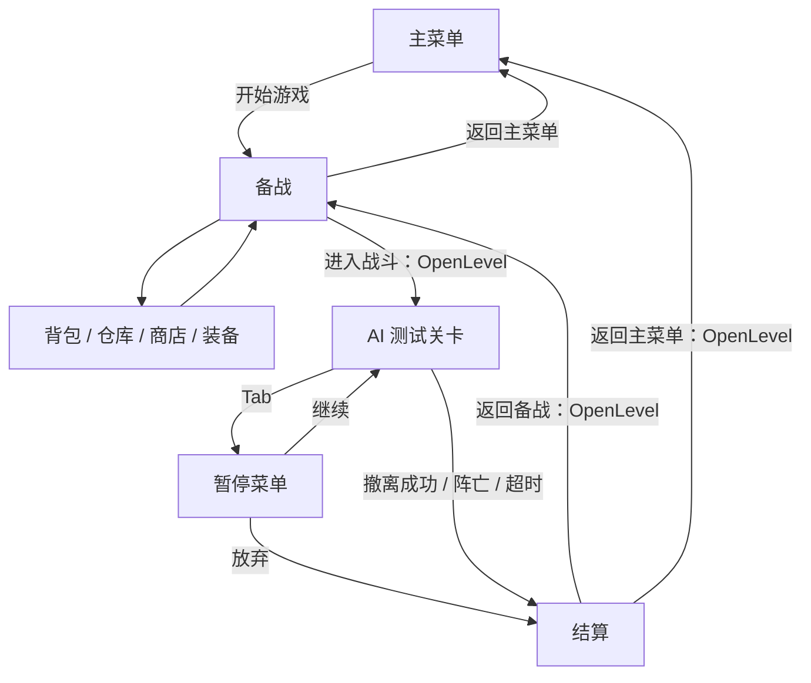

# 游戏流程原型：阅读与验证

## 如何体验

使用现有 TPSdemo.uproject，默认启动地图已经改为 Content/CandyFight/Maps/L_CandyFight_Frontend.umap。

1. 打开项目，确认当前关卡是 L_CandyFight_Frontend，然后点击“运行”。
2. 点击“开始游戏”进入备战。
3. 背包、仓库、商店、装备分别可以打开说明页面，再返回备战。
4. 点击“进入战斗”，切换到已有的 L_CandyFight_AI_Test。
5. 保持原有移动、瞄准、武器、宝箱和撤离门玩法。按 Tab 打开暂停菜单，可以继续或放弃并结算。
6. 战斗中按 B 打开 6×6 背包（ESC 关闭）；靠近开局生成的测试道具按 E 拾取，选中格子后可以使用或丢弃。详见 `Docs/背包功能_使用与验证.md`。
7. 撤离成功、生命值归零、全局倒计时结束或主动放弃，都会打开结算页。
8. 结算页可以返回备战或主菜单，再次开局。

编辑器中 Esc 通常会停止 PIE，所以体验流程时优先使用 Tab。独立游戏中也绑定了 Esc。
如果直接运行 AI 测试地图，会直接开始战斗；要从主菜单体验，请先打开 Frontend 地图。

## 当前完成的范围

菜单和四个备战入口都使用原生 C++ UMG 控件，页面仅提供文本和导航。
战斗复用已有 AI 测试地图，不新增一套战斗系统。
结算显示结果、本局金币和战斗时长，成功与失败都只展示数字，没有存档、交易、扣款或仓库入库。
战斗时长使用游戏世界时间，暂停期间不增加。
返回前台后再次开局会重新载入战斗地图，重新创建玩家、敌人、宝箱、计时器与 PlayerState。

当前角色蓝图的最大生命值仍是原有的 1,000,000；这会让手动体验阵亡变得困难。本次没有修改它。

## 流程图



## 先看哪些代码

| 文件 | 职责 |
| --- | --- |
| Source/TPSdemo/CandyFight/Flow/CandyFightFlow.h | 界面状态、结算结果、GameInstance 与前台 GameMode 的声明 |
| Source/TPSdemo/CandyFight/Flow/CandyFightFlow.cpp | 页面切换、关卡加载、暂停、结束本局及输入模式 |
| Source/TPSdemo/CandyFight/Flow/CandyFightFlowWidget.cpp | 页面文本、按钮、点击回调；以后可以用设计好的 UMG 替换 |
| Source/TPSdemo/CandyFight/CandyFightGameMode.cpp | 战斗开始与全局倒计时结束时通知流程 |
| Source/TPSdemo/CandyFight/CandyFightCharacter.cpp | 敌方伤害使生命值归零时通知流程 |
| Source/TPSdemo/CandyFight/Interaction/CandyFightEscapeGate.cpp | 已有撤离条件全部满足后通知流程 |
| Source/TPSdemo/CandyFight/Inventory/CandyFightInventoryComponent.cpp | 6×6 背包、拾取/使用/丢弃、B 键界面与暂停恢复 |
| Source/TPSdemo/CandyFight/Inventory/CandyFightItemPickup.cpp | 地面可拾取物品与世界提示 |
| Source/TPSdemo/CandyFight/UI/CandyFightInventoryWidget.cpp | 原生 C++ UMG 背包界面 |
| Source/TPSdemo/CandyFight/Elements/CandyFightElementAuraComponent.cpp | 元素附着、GU 衰减、头顶光球与标签 |
| Source/TPSdemo/CandyFight/Elements/CandyFightElementReactionComponent.cpp | 蒸发/融化/冻结/碎冰结算 |
| Source/TPSdemo/CandyFight/Elements/CandyFightFrozenEffectComponent.cpp | 冻结状态、停走/停火、材质与解冻 |
| Source/TPSdemo/CandyFight/Elements/CandyFightReactionRules.cpp | 可覆盖的反应规则表 |
| Source/TPSdemo/CandyFight/Weapons/CandyFightCombatComponent.cpp | Q 切元素、枪身染色、弹道元素快照 |
| Source/TPSdemo/CandyFight/Tests/CandyFightElementReactionTests.cpp | 元素附着/反应/冻结/枪械切换测试 |
| Source/TPSdemo/CandyFight/Tests/CandyFightInventoryTests.cpp | 背包数据与界面自动化测试 |
| Config/DefaultEngine.ini | 默认地图与 GameInstance 类型 |
| Config/DefaultGame.ini | 两张流程地图加入 MapsToCook |
| Scripts/CreateFlowFrontend.py | 菜单地图生成工具；地图已生成，平时无需运行 |
| Scripts/VerifyFlowPIE.py | 实际运行中反复切图、触发四种结算的验证脚本 |
| Source/TPSdemo/CandyFight/Tests/CandyFightFlowTests.cpp | 结果快照、重复结束回调和下一局重置的自动化测试 |

推荐先阅读：状态枚举 → Widget 的 Primary/Secondary → GameInstance 的 StartBattle/BeginBattle → FinishBattle → ReturnFromBattle。

## 关键概念

**GameInstance 跨地图保留。** 本项目用 UCandyFightGameInstance 管理当前页面和上一局结果。OpenLevel 会销毁旧世界里的角色与 GameMode，所以结算数据应先拷贝到这里。

**GameMode 随地图创建。** 菜单地图指定 ACandyFightFrontendGameMode，只展示前台界面；战斗地图继续使用原有 BP_CandyFightGameMode。战斗 GameMode 的 StartPlay 调用 BeginBattle。

**Widget 负责显示和按钮。** 它不直接创建敌人、发放资源或判断撤离。按钮调用 GameInstance，由流程管理器决定下一步。

**结算只提交一次。** FCandyFightRunLedger::Finish 在第一条有效结束事件到来时记录结果。随后收到的超时、伤害或重复回调不会覆盖它。下一次 BeginBattle 会开始一份新记录。

**结算冻结战斗世界。** FinishBattle 停止战斗组件和搜索，暂停游戏，再显示可操作的 UI。返回时先解除暂停、释放战斗输入，再切换关卡。

**鼠标模式随界面改变。** 前台、暂停和结算使用 UI 输入和可见鼠标；战斗恢复隐藏鼠标、相对输入与现有虚拟准星。

## 本次验证

- TPSdemoEditor / Win64 / Development 编译成功。
- 9 项相关自动化测试全部通过：CandyFight.Flow（2）、CandyFight.Escape（4）、CandyFight.PlayerHealth（3）。
- 编辑器运行验证：主菜单、四个入口、进入原有 AI 测试地图、暂停和继续、四种结算、返回备战、返回主菜单及连续开局。
- 撤离通过真实撤离门计时触发；阵亡通过真实敌方控制器施加伤害触发；超时通过加速 PIE 世界时间等待真实 GameMode 计时结束触发。
- 每种结算验证金币快照、暂停状态和重复提交保护；每次新开局验证金币与撤离状态重置。
- 通过 MCP 注入 Tab 按键验证了打开暂停菜单；恢复战斗通过界面按钮验证。
- 以上测试只改变运行中的 PIE 世界，不保存测试位置、敌人或时间倍率。
- 旧测试里的生命值初始化现在显式设置为 100，避免测试数字受角色蓝图当前生命值设置影响。
- 本次未验证打包产物或多人游戏。

## 元素反应与枪械

元素反应系统的设计与分层说明见 `Docs/元素反应系统.md`。
玩家枪械默认火元素，按 `Q` 在火/水/冰间循环；命中先写附着，再按规则表结算蒸发、融化、冻结与碎冰。
投射物在开火瞬间快照元素，切换元素不会改变在飞的子弹；AI 枪械默认物理元素。
测试地图 `L_CandyFight` 正前方有 200 HP 靶子，可直接验证元素光球、世界文字和伤害倍率。

本次验证：`CandyFight.Elements` 7 项自动化测试通过，全量 `CandyFight` 74 项通过；
PIE 中确认 Q 循环、枪械染色/ HUD 元素状态、实际弹丸命中后反应层记录到冻结反应。

## 背包功能

战斗内背包的完整操作、测试物品和验证步骤见 `Docs/背包功能_使用与验证.md`。
简要规则：战斗中按 B 打开 6×6 网格，一个物品占一格，E 拾取地面物品，
选中后可使用或丢弃，ESC 或再次按 B 关闭。开局会在玩家前方生成测试物品，可在
`BP_CandyFightGameMode` 的 `CandyFight|Test Pickups` 分类中关闭。

背包本次验证：`CandyFight.Inventory` 3 项自动化测试通过，全量 `CandyFight` 74 项通过
（含元素反应 7 项）；PIE 中验证了 B 打开/关闭、ESC 关闭、E 拾取、使用金券 +30 金币、
丢弃生成新掉落物，以及暂停期间的界面刷新。

## 重新运行验证脚本

先打开 Frontend 地图并点击运行，停留在主菜单，然后在输出日志的 Python 输入中执行：

```python
import unreal
path = unreal.Paths.convert_relative_path_to_full(unreal.Paths.project_dir() + "Scripts/VerifyFlowPIE.py")
exec(compile(open(path, encoding="utf-8-sig").read(), path, "exec"))
```

脚本会自动测试四个入口、四种结算及多次切图；大约几十秒，结束时停留在备战。
搜索日志中的 [FlowPIE]，最终应看到 ALL COMPLETE。不要在脚本运行时手动操作游戏。
脚本会在 PIE 内临时移除敌人、传送玩家、施加伤害和加速时间；停止运行即丢弃这些变化。
自动化单元测试可在“会话前端 / 自动化”中搜索上述 CandyFight 测试组并执行。

## 后续可以从哪里扩展

先用 UMG 蓝图替换四个说明页，并保留对 GameInstance 导航方法的调用。
需要真实资源流转时，再设计持久数据、入场装备快照、成功撤离入库及失败损失规则。
这次的 Gold 字段只是本局展示值，不应直接当作永久余额。
